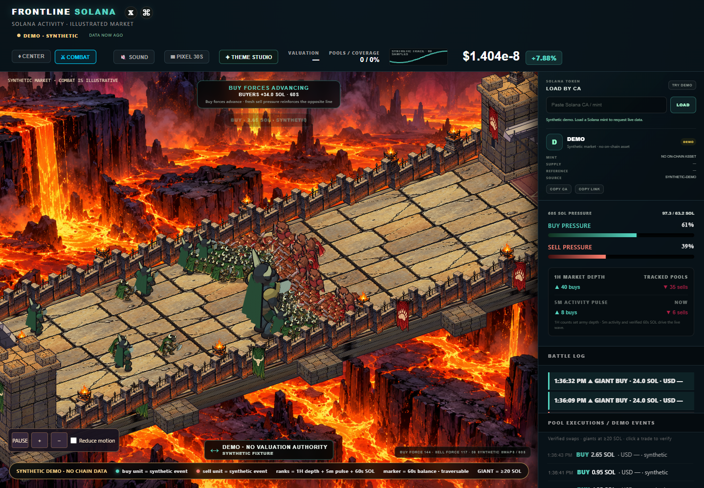

# Frontline

Frontline visualizes Solana token activity and price as an illustrated 2D battlefield. Buy and sell forces respond to market flow; combat is a visual metaphor and never sets a token price.

**The 2D candidate has been accepted; publication is in progress.** The requested giant-orientation correction is verified in both families. See [release status](docs/frontline/RELEASE.md) and [art scope](docs/frontline/ART.md).



## Run without services

Use Node 22.12 or newer within the Node 22 series (validated with Node 22.18), then:

```sh
npm ci --ignore-scripts --legacy-peer-deps
npm run dev -- --host 127.0.0.1
```

Open the printed local URL. The default is **DEMO · SYNTHETIC**: a reproducible synthetic sequence with no provider requests, signatures, wallets or keys. It exercises the same UI, force formulas, presentation runtime, rigs and renderer as live mode. It is not a historical replay or an on-chain asset.

Paste a Solana mint and select **LOAD** to request real data. Failed resolution leaves the current selection visible; an unresolved deep link stays unresolved. **TRY DEMO** is an explicit recovery action. Successful selections support refresh, copied links and browser history.

## Demo and live data

| Surface | Meaning |
| --- | --- |
| Demo events | Synthetic fixtures; no transaction links or chain verification claims |
| Live price / provider valuation | DexScreener indicative data, independently labeled; not an executable quote |
| Verified live swaps | Canonical pool executions admitted by the v4 relay, with mint, pool, epoch and settlement checks |
| 60-second pressure | Confirmed/finalized SOL-quoted pool executions only; stablecoin amounts are never converted into invented SOL pressure |
| Army depth | Existing sub-linear weighting of one-hour counts, five-minute activity and verified 60-second flow |
| Detailed actors | At most eight recent swaps per side; large size starts at 20 SOL and grants no Commander or User Champion identity |
| Aggregate ranks | Market activity summaries; never individual transactions |
| Main chart | Reference-pool minute closes over one hour when available; synthetic sample trace in Demo |
| Pixel / PiP | Rolling 30-second swaps and sampled price trace, labeled Demo when synthetic; not OHLCV |

The frontend can resolve supported Solana pools without secrets. Verified acquisition needs a configured relay. With no relay configured, live discovery remains available but execution coverage is **degraded**, with no invented troops. A socket alone never establishes LIVE status. Unknown, stale and unavailable values stay explicit.

The bounded portfolio relay admits up to two operator-configured mints, uses verified polling and reserves a shared account-wide maximum of 30 RPC requests per minute and 3,000 per UTC day. This bounds upstream request counts, not dollar billing or Cloudflare ingress. Other compatible mints can still show provider discovery/indicative prices. See [maintenance](docs/frontline/RUNBOOK.md) for capabilities and limits.

## Architecture

```text
providers → validation / canonical journal → per-mint state
        → fixed-step presentation runtime → immutable frame → Pixi 2D
```

Token sessions own cancellation and generations. Market authority stays in the pure financial domains and v4 relay. A single numerical presentation runtime in a dedicated Worker advances movement, target selection and contact; at most one unacknowledged frame is pending. The renderer reads frames, interpolates articulated poses and owns graphical resources. Animation callbacks never create trades or numerical hits. Three.js is absent from the production graph; the previous implementation remains in Git for rollback.

Drag to pan, use **+ / −** to zoom, **CENTER** to frame both bases or **COMBAT** for detail. Keyboard focus supports arrows, +/−, Home and Space. Pause freezes presentation while acquisition continues; resuming reconstructs recent activity without an unbounded queue. Visibility suspension stops drawing and numerical advancement. Theme Studio edits supported 2D controls and retains legacy 3D fields on import without claiming a visual equivalent. Pixel uses native video PiP where supported, with explicit failure feedback.

## Quality and support

```sh
npm run lint
npm test
npm run build
npm run test:e2e
```

E2E builds and serves the optimized application under both / and /frontline/, with external HTTP/WS blocked before navigation. Frozen 3D E2E files are retained as historical evidence; the active suite targets the 2D product. Current results, source hashes and measured limits are recorded in [validation](docs/frontline/VALIDATION.md), separately from historical campaigns.

| Environment | Support / limit |
| --- | --- |
| Chromium desktop | Local browser validation |
| Mobile Chromium | Responsive and touch emulation; not physical Android certification |
| WebGL 2 / WebGL 1 | Continuous articulated rigs; pinned Pixi adapter for GL1 image textures |
| Canvas | Compatible atlas animation; no claim of continuous-rig equivalence |
| No graphics / failed assets | HTML data, token controls and feed remain usable |
| Native PiP | Browser-dependent; no silent popup substitute |
| Physical iOS, Android, modest iGPU | Pending physical procedure; no universal FPS claim |

## Project notes

[Technical case study](docs/frontline/CASE_STUDY.md) · [Runbook](docs/frontline/RUNBOOK.md) · [Release and rollback](docs/frontline/RELEASE.md) · [Selected transfers](docs/frontline/transfer-manifest.json).

Implementation used AI assistance for code, investigation, tests, documentation and selected generated art. The repository and evidence expose the decisions and limits; no clients, users, revenue or independent review are invented.

Code: [MIT](LICENSE). Third-party code and selected art have their own terms and distribution status: [notices](THIRD_PARTY_NOTICES.md).
